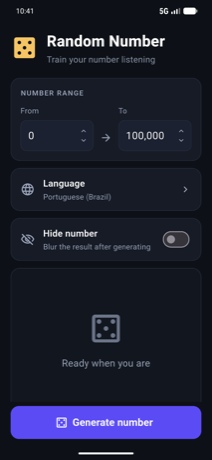
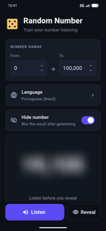
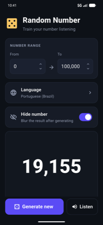
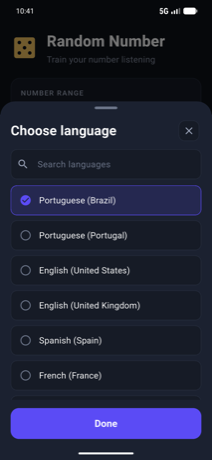

<div align="center">

# Dyatel

**Train your number listening**

A Flutter app for Android and iOS that drills numbers by ear — generate a random
number, hear it spoken in one of 15 languages, and check yourself before revealing it.

</div>

---

Learning a language and still translating numbers in your head? Dyatel throws random
numbers at you, says them out loud, and keeps the answer blurred until you commit to a guess.

*Дятел* is Russian for **woodpecker** — a bird known for relentless, repetitive drilling.
Which is exactly how you learn numbers.

## Screenshots

| Ready | Listen first | Revealed | Languages |
| :---: | :---: | :---: | :---: |
|  |  |  |  |

## Features

- **Any range you like** — 0 to 100,000 out of the box, adjustable with grouped-digit
  fields and a stepper.
- **Hear the number** — tap **Listen** and it is read aloud in the language you picked.
- **15 languages** — Portuguese (Brazil / Portugal), English (US / UK), Spanish, French,
  German, Italian, Dutch, Polish, Russian, Turkish, Japanese, Korean and Mandarin,
  searchable from the picker.
- **Hide number** — blurs the result so you listen first and reveal afterwards.
  Tap the blur, or **Reveal**, to check yourself.
- **Remembers your setup** — range, language and the hide toggle survive a restart.

A practice loop: turn on **Hide number**, tap **Generate number**, tap **Listen**,
say the answer out loud, then **Reveal** to see whether you got it.

## How the speech works

Dyatel asks Google Translate's text-to-speech endpoint for the audio, because its voices
are noticeably smoother than the ones bundled with most devices. The number is sent as a
bare numeral — Google expands it into words in the target language itself, which is why one
picker covers all 15 languages without a per-language spelling table.

If that endpoint cannot be reached — offline, or rate limited — the app falls back to the
on-device speech engine for the selected language and tells you it did. No API key either way.

> **Note:** the Google endpoint is undocumented and could change without warning. The
> on-device fallback exists so the app degrades rather than breaks.

## Installing

Grab `dyatel-<version>.apk` from the [latest release](https://github.com/zavanton123/dyatel-app/releases/latest)
and install it on an Android device with unknown sources enabled.

> Release APKs are currently signed with the Android debug key, so they are fine for
> sideloading but not for the Play Store.

## Development

```bash
flutter pub get
flutter run                      # on a connected device or emulator
flutter test                     # unit and widget tests
flutter analyze
dart format .
```

Building a release APK:

```bash
flutter build apk --release
```

> If that fails with a bare version number such as `25.0.3`, Gradle has been handed a JDK it
> cannot parse — usually Android Studio's bundled one. Point Flutter at JDK 17:
> `flutter config --jdk-dir /path/to/jdk-17`.

### Layout

| Path | What lives there |
| --- | --- |
| `lib/screens/` | The single screen and its action bar |
| `lib/widgets/` | Range field, option rows, result panel, language sheet |
| `lib/services/` | Speech (Google + on-device fallback) and persisted settings |
| `lib/models/` | The supported language list |
| `lib/utils/` | Digit grouping and parsing |

## Releasing

Push a tag matching the version in `pubspec.yaml` and CI builds the APK and attaches it
to the GitHub release:

```bash
git tag 1.0.1 && git push --follow-tags
```

The [release workflow](.github/workflows/release.yml) refuses to publish when the tag and
`pubspec.yaml` disagree. [CI](.github/workflows/ci.yml) checks formatting, analysis and
tests on every push and pull request.
